<!-- ================================================================
     README de perfil · assets animados propios en /assets
     Stats y 3D generados por GitHub Actions en /profile y
     /profile-3d-contrib · arcade en la rama `output`.
================================================================= -->

<div align="center">


<a href="https://koptup.com">
  
</a>

<p>
  
  <a href="https://github.com/ronalc90?tab=followers"></a>
  <a href="https://koptup.com"></a>
</p>
<p>
  
  
  
</p>
<p>
  <a href="#juegos"></a>
</p>

</div>


## 🏜️ Sobre mí

<div align="center">
  
</div>

<br/>

Desarrollador de software que diseña e implementa soluciones **modernas, escalables y centradas en el usuario**. Combino **React/TypeScript** en el frontend con **Node.js, Java y Python** en el backend, sobre arquitecturas **REST y microservicios**. Últimamente me especialicé en **backend para chatbots inteligentes** con OpenAI, recuperación semántica, embeddings y vector stores.

<div align="center">
  
</div>

<br/>

- 🌱 **Explorando:** agentes de IA, RAG avanzado y juegos con WebGL2
- 💬 **Hablemos de:** APIs, arquitectura backend, chatbots e integración de IA en productos reales

<details>
<summary><b>📜 Ver ficha técnica (YAML)</b></summary>
<br/>

```yaml
name: Ronald Demian Cipagauta Penagos
role: Full Stack Developer
location: Colombia 🇨🇴
email: ronalddemiancipagauta@gmail.com
phone: "+57 302 479 4842"
portfolio: koptup.com

focus:
  - ⚛️  Frontend: React, TypeScript, Angular
  - 🖥️  Backend: Node.js, Java, Python, .NET
  - 🤖  AI/Chatbots: OpenAI API, embeddings, vector stores
  - ☁️  Cloud: AWS (S3), Vercel, CI/CD pipelines
  - 🔀  Data Flows: Apache NiFi
  - 🗄️  Databases: Oracle, SQL Server, MySQL, MongoDB

currently_working_on:
  - "SII Group — Backend Developer para Falabella"
  - "Blautech, para Claro CENAM — Flujos de datos con Apache NiFi"
```

</details>


## ⚔️ Lo que ofrezco

<div align="center">

| 🌐 Desarrollo Web | 🔌 APIs & Backend | 🤖 AI & Chatbots |
|:-----------------:|:-----------------:|:----------------:|
| React, Angular, TypeScript | Node.js, Java, Spring Boot | OpenAI, Embeddings, RAG |
| Apps modernas y responsivas | REST APIs, Microservicios | Chatbots inteligentes |
| Integraciones eCommerce | JWT, Seguridad, Auth | Búsqueda semántica |

| ☁️ Cloud & DevOps | 🗄️ Bases de Datos | 🖥️ Desktop Apps |
|:------------------:|:-----------------:|:---------------:|
| AWS S3, Vercel | Oracle, SQL Server | WPF + .NET |
| CI/CD Pipelines | MySQL, MongoDB | Apps empresariales |
| Git, Bitbucket, JIRA | Stored Procedures | SQL Server integrado |

</div>


## 🛠️ Arsenal

<div align="center">



<br/>


</div>

<details>
<summary><b>Ver arsenal por categoría</b></summary>
<br/>
<div align="center">

**💻 Lenguajes**<br/><br/>


**⚙️ Frameworks & Librerías**<br/><br/>


**🗄️ Bases de Datos**<br/><br/>


**☁️ Cloud / DevOps / Herramientas**<br/><br/>


</div>
</details>


## 🗺️ Travesía profesional

<table width="100%">
  <tr>
    <td width="14%" align="center"><b>may. 2026</b><br/><sub>🟢 Actualidad</sub></td>
    <td>
      <b>📡 Blautech — Desarrollador de integración para Claro CENAM</b><br/>
      Flujos en Apache NiFi para la activación automática de servicios de streaming en clientes de telecomunicaciones de varios países, con reintentos, alertas a monitoreo y logging por registro. Integración con Oracle y validación de APIs con Postman, migración de secretos a Vault y pull requests en GitHub Enterprise con Conventional Commits.<br/>
      <sub>Apache NiFi · Oracle SQL · Vault · Keycloak · Java · Postman · Git/GitHub</sub>
    </td>
  </tr>
  <tr>
    <td width="14%" align="center"><b>jun. 2026</b><br/><sub>🟢 Actualidad</sub></td>
    <td>
      <b>🏦 SII Group — Desarrollador Full Stack (cliente: Banco Falabella Colombia)</b><br/>
      Continuidad en el sistema de conciliación transaccional del banco tras el cambio de proveedor: el mismo proyecto y el mismo cliente. Reglas de conciliación y postconciliación en T-SQL sobre procesos batch de alto volumen, optimización de rendimiento (planes de ejecución, índices y reescritura de consultas) y despliegues versionados con Git y GitLab CI, con scripts de reverso y trazabilidad en auditoría.<br/>
      <sub>SQL Server · T-SQL · Python · Git · GitLab CI · Jira · Confluence</sub>
    </td>
  </tr>
  <tr>
    <td width="14%" align="center"><b>nov. 2025</b><br/><sub>→ jun. 2026</sub></td>
    <td>
      <b>🏦 BC Tecnología — Desarrollador Full Stack (cliente: Banco Falabella Colombia)</b><br/>
      Sistema de conciliación transaccional del banco: el proceso diario que cruza las transacciones de tarjetas reportadas por Redeban, Mastercard, cajeros, POS e internet contra el switch, y del que dependen la contabilidad, la facturación de redes y la reportería. Reglas de conciliación en T-SQL, herramienta en Python para validar scripts SQL antes de ejecutarlos, revisión de pares, diagnóstico de defectos y documentación técnica y funcional.<br/>
      <sub>SQL Server · T-SQL · Python · Git · GitLab CI · Jira · Confluence</sub>
    </td>
  </tr>
  <tr>
    <td width="14%" align="center"><b>2024</b><br/><sub>→ 2025</sub></td>
    <td>
      <b>🤖 Globa — Desarrollador Full Stack</b><br/>
      React + TypeScript en frontend y Node.js/TypeScript en backend. Chatbots inteligentes con OpenAI API, embeddings, vector stores y recuperación semántica. Procesamiento de documentos (PDF, DOCX, HTML, TXT), microservicios, AWS (S3), JWT y pipelines CI/CD.
    </td>
  </tr>
  <tr>
    <td width="14%" align="center"><b>2023</b><br/><sub>→ 2024</sub></td>
    <td>
      <b>🎓 Universitas XXI — Desarrollador Full Stack</b><br/>
      Arquitectura modular por capas con Java EE y REST sobre WebLogic. Interfaces en Oracle APEX, pruebas unitarias con JUnit, CI/CD, Git/Bitbucket, JIRA y soporte en entornos preproductivos y productivos.
    </td>
  </tr>
  <tr>
    <td width="14%" align="center"><b>2020</b><br/><sub>→ 2023</sub></td>
    <td>
      <b>🌐 Koptup — Desarrollador Full Stack & Consultor Tecnológico</b><br/>
      Soluciones a medida con React, Angular, TypeScript. Apps de escritorio WPF + SQL Server, integraciones AWS S3, autenticación JWT, despliegues en Vercel, eCommerce personalizados y consultoría técnica.
    </td>
  </tr>
</table>

## 📜 Educación

<div align="center">

| Título | Institución | Estado |
|--------|-------------|--------|
| 🎓 Ingeniería de Desarrollo de Software | Politécnico Grancolombiano | En curso (homologando) |
| 📚 Tecnología en Sistematización de Datos | Universidad Distrital Francisco José de Caldas | Materias terminadas |

</div>


## 📊 Estadísticas del viajero

<div align="center">




</div>

### 🧱 Contribuciones en 3D

<div align="center">
  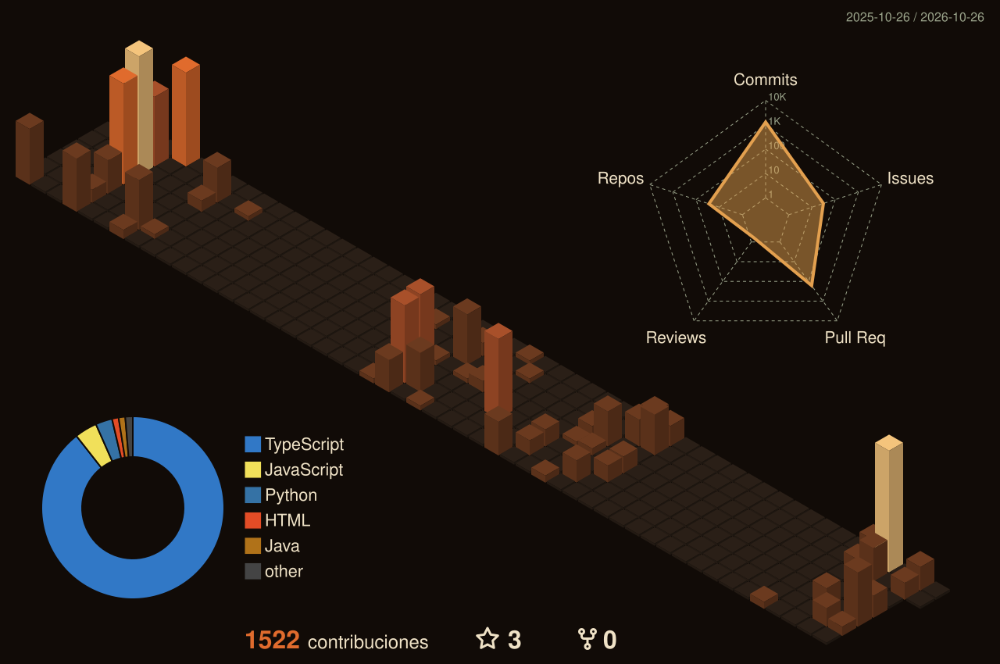
</div>

### 🕹️ Arcade de contribuciones

<div align="center">

<picture>
  <source media="(prefers-color-scheme: dark)" srcset="https://raw.githubusercontent.com/ronalc90/ronalc90/output/github-snake-dark.svg"/>
  <source media="(prefers-color-scheme: light)" srcset="https://raw.githubusercontent.com/ronalc90/ronalc90/output/github-snake.svg"/>
  
</picture>

<picture>
  <source media="(prefers-color-scheme: dark)" srcset="https://raw.githubusercontent.com/ronalc90/ronalc90/output/pacman-contribution-graph-dark.svg"/>
  <source media="(prefers-color-scheme: light)" srcset="https://raw.githubusercontent.com/ronalc90/ronalc90/output/pacman-contribution-graph.svg"/>
  
</picture>

</div>


## 🏗️ Proyectos destacados

<table width="100%">
  <tr>
    <td width="50%" valign="top">
      <a href="https://www.koptup.com">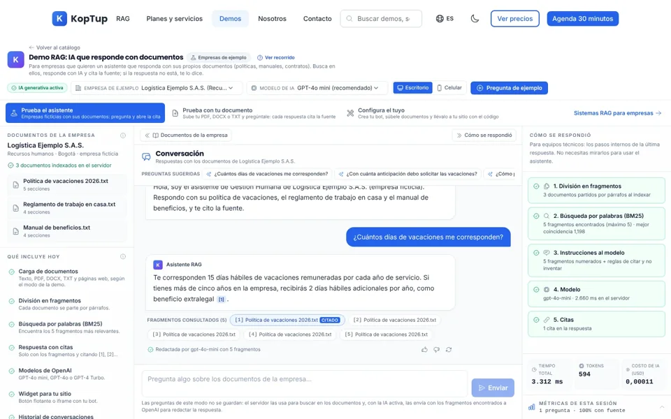</a>
      <h3>🌐 <a href="https://github.com/ronalc90/koptup">Koptup</a></h3>
      Sistemas <b>RAG</b>: IA que responde con los documentos de la empresa y <b>cita la fuente</b>. Catálogo de <b>28 demos</b> interactivos.<br/><br/>
      
      
      
      
      <a href="https://www.koptup.com"></a>
    </td>
    <td width="50%" valign="top">
      <a href="https://bioluma-xi.vercel.app">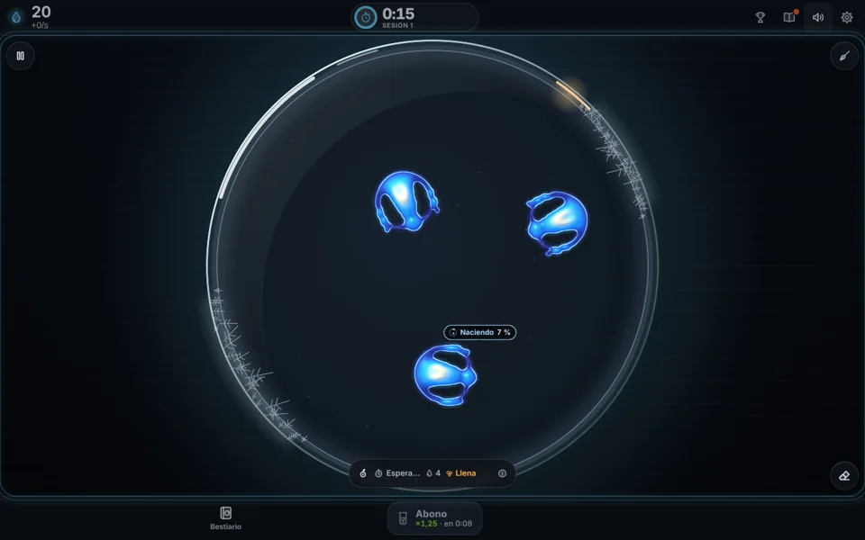</a>
      <h3>🧫 <a href="https://github.com/ronalc90/Lenia">Bioluma</a></h3>
      Juego incremental de <b>vida artificial</b>: criaturas Lenia simuladas en vivo en la <b>GPU</b> del navegador con WebGL2. Web instalable (PWA).<br/><br/>
      
      
      
      <a href="https://bioluma-xi.vercel.app"></a>
    </td>
  </tr>
  <tr>
    <td width="50%" valign="top">
      <a href="https://motattomotocicletas.com">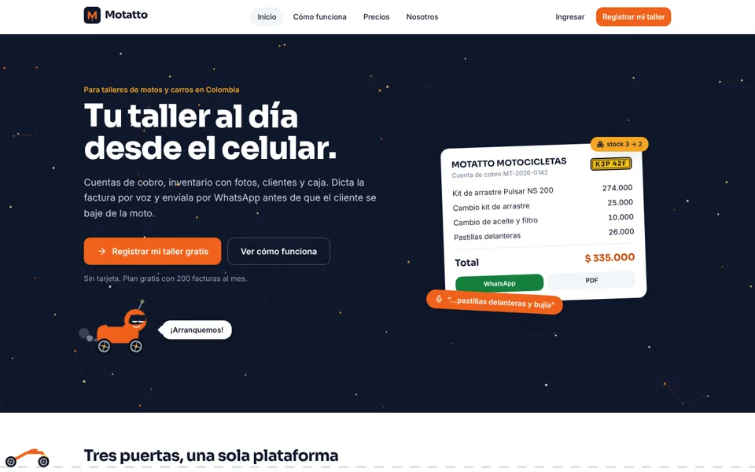</a>
      <h3>🏍️ <a href="https://github.com/ronalc90/motattomotocicletas">Motatto</a></h3>
      Plataforma <b>multitenant</b> para talleres de motos y carros: cuentas de cobro por WhatsApp y PDF, inventario, caja y reportes.<br/><br/>
      
      
      
      
      <a href="https://motattomotocicletas.com"></a>
    </td>
    <td width="50%" valign="top">
      <a href="https://meraki-wine.vercel.app">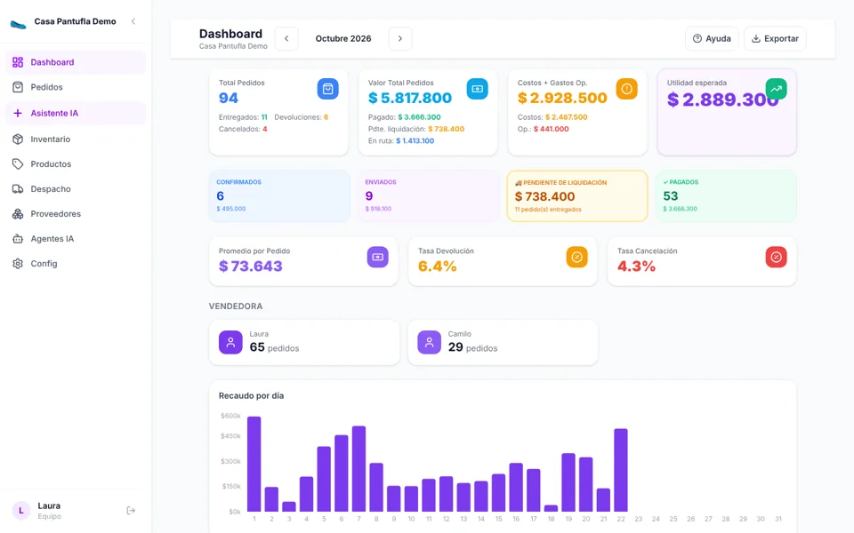</a>
      <h3>🛒 <a href="https://github.com/ronalc90/koptup-comercio-electronico">Koptup Comercio</a></h3>
      SaaS para comercios: pedidos por WhatsApp o voz con <b>IA que valida el stock</b>, inventario por variante, despachos y finanzas.<br/><br/>
      
      
      
      <a href="https://meraki-wine.vercel.app"></a>
    </td>
  </tr>
  <tr>
    <td width="50%" valign="top">
      <a href="https://www.saludadultomayor.org">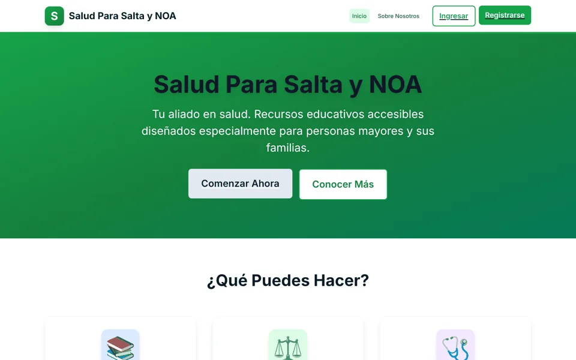</a>
      <h3>🩺 <a href="https://github.com/ronalc90/saludSalta_Noa">Salud Adulto Mayor</a></h3>
      Plataforma <b>accesible</b> de educación en salud para personas mayores de Salta: clases en video, IMC y orientación por síntomas con <b>ML</b>.<br/><br/>
      
      
      
      <a href="https://www.saludadultomayor.org"></a>
    </td>
    <td width="50%" valign="top">
      <a href="https://github.com/ronalc90/Visual-code-Latigo-Claude#readme">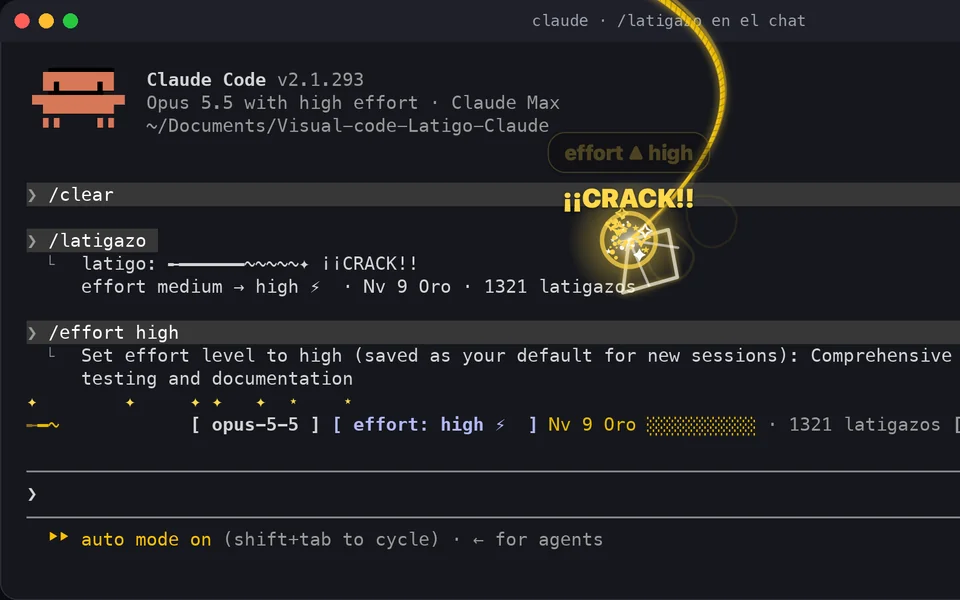</a>
      <h3>⚡ <a href="https://github.com/ronalc90/Visual-code-Latigo-Claude">Látigo para Claude Code</a></h3>
      <b>Plugin de Claude Code</b> + <b>extensión de VS Code</b> + <b>app de Mac</b>: cada latigazo sobre la conversación sube el effort de Claude un nivel.<br/><br/>
      
      
      
      <a href="https://github.com/ronalc90/Visual-code-Latigo-Claude#readme"></a>
    </td>
  </tr>
</table>


<a name="juegos"></a>

## 🕹️ Zona de juegos

<sub>Sí: se puede jugar desde este perfil. Los ataques y firmas abren un *issue* prellenado; un GitHub Action lo procesa y actualiza este README.</sub>

### 🔥 CENIZA · sobrevive a la furia del coloso

<div align="center">
  <a href="https://ronalc90.github.io/ronalc90/">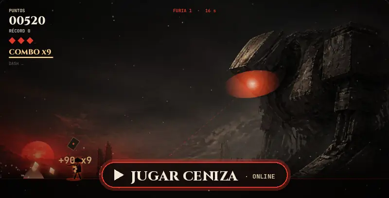</a>
  <br/>
  <sub>Mini juego en el navegador (PC y móvil) · <b>4 armas</b> (hoja, arco, martillo y lanza) · <b>3 jefes intermedios</b> con cofres de mejoras · dash con esquiva perfecta · <b>árbol de habilidades</b> que crece cada vez que caes</sub>
</div>

### ⚔️ Raid comunitario contra el coloso

<div align="center">


**Elige tu arma y ataca:**

<a href="https://github.com/ronalc90/ronalc90/issues/new?title=raid%3A%20espada&body=%E2%9A%94%EF%B8%8F%20%2A%2A%C2%A1No%20cambies%20el%20t%C3%ADtulo%21%2A%2A%20Solo%20pulsa%20%2A%2ACreate%2A%2A%20para%20lanzar%20tu%20ataque.%0A%0AEl%20bot%20lo%20procesar%C3%A1%20en%20unos%20segundos%2C%20te%20responder%C3%A1%20aqu%C3%AD%20con%20el%20da%C3%B1o%20que%20hiciste%20y%20actualizar%C3%A1%20el%20perfil.%0A%0A_Cada%20guerrero%20puede%20atacar%20una%20vez%20cada%2020%20minutos._"></a>
<a href="https://github.com/ronalc90/ronalc90/issues/new?title=raid%3A%20arco&body=%E2%9A%94%EF%B8%8F%20%2A%2A%C2%A1No%20cambies%20el%20t%C3%ADtulo%21%2A%2A%20Solo%20pulsa%20%2A%2ACreate%2A%2A%20para%20lanzar%20tu%20ataque.%0A%0AEl%20bot%20lo%20procesar%C3%A1%20en%20unos%20segundos%2C%20te%20responder%C3%A1%20aqu%C3%AD%20con%20el%20da%C3%B1o%20que%20hiciste%20y%20actualizar%C3%A1%20el%20perfil.%0A%0A_Cada%20guerrero%20puede%20atacar%20una%20vez%20cada%2020%20minutos._"></a>
<a href="https://github.com/ronalc90/ronalc90/issues/new?title=raid%3A%20bomba&body=%E2%9A%94%EF%B8%8F%20%2A%2A%C2%A1No%20cambies%20el%20t%C3%ADtulo%21%2A%2A%20Solo%20pulsa%20%2A%2ACreate%2A%2A%20para%20lanzar%20tu%20ataque.%0A%0AEl%20bot%20lo%20procesar%C3%A1%20en%20unos%20segundos%2C%20te%20responder%C3%A1%20aqu%C3%AD%20con%20el%20da%C3%B1o%20que%20hiciste%20y%20actualizar%C3%A1%20el%20perfil.%0A%0A_Cada%20guerrero%20puede%20atacar%20una%20vez%20cada%2020%20minutos._"></a>

<sub>Espada: daño estable · Arco: daño variable · Bomba: mucho daño, pero a veces la mecha se apaga</sub>

</div>

<!-- RAID:START -->
<div align="center">

| | Guerrero | Daño | Ataques | Golpes finales |
|:-:|:--|--:|--:|--:|
| 🥇 |  [@ronalc90](https://github.com/ronalc90) | 45 | 1 | 0 |

</div>

<details><summary><b>Bitácora de batalla</b></summary>

- 🗡️ [@ronalc90](https://github.com/ronalc90) hizo **−45** contra el Nv. 1 · <sub>hace 1 min</sub>

</details>
<!-- RAID:END -->

### 🏕️ Libro de visitas · únete a la caravana

<div align="center">


**Firma como:**

<a href="https://github.com/ronalc90/ronalc90/issues/new?title=firma%3A%20viajero&body=%F0%9F%8F%95%EF%B8%8F%20%2A%2A%C2%A1No%20cambies%20el%20t%C3%ADtulo%21%2A%2A%20Solo%20pulsa%20%2A%2ACreate%2A%2A%20para%20firmar%20el%20libro%20de%20visitas.%0A%0ATu%20avatar%20se%20unir%C3%A1%20a%20la%20caravana%20que%20cruza%20el%20desierto%20en%20el%20perfil.%20%C2%A1Gracias%20por%20pasar%2C%20viajero%21"></a>
<a href="https://github.com/ronalc90/ronalc90/issues/new?title=firma%3A%20mercader&body=%F0%9F%8F%95%EF%B8%8F%20%2A%2A%C2%A1No%20cambies%20el%20t%C3%ADtulo%21%2A%2A%20Solo%20pulsa%20%2A%2ACreate%2A%2A%20para%20firmar%20el%20libro%20de%20visitas.%0A%0ATu%20avatar%20se%20unir%C3%A1%20a%20la%20caravana%20que%20cruza%20el%20desierto%20en%20el%20perfil.%20%C2%A1Gracias%20por%20pasar%2C%20viajero%21"></a>
<a href="https://github.com/ronalc90/ronalc90/issues/new?title=firma%3A%20guerrero&body=%F0%9F%8F%95%EF%B8%8F%20%2A%2A%C2%A1No%20cambies%20el%20t%C3%ADtulo%21%2A%2A%20Solo%20pulsa%20%2A%2ACreate%2A%2A%20para%20firmar%20el%20libro%20de%20visitas.%0A%0ATu%20avatar%20se%20unir%C3%A1%20a%20la%20caravana%20que%20cruza%20el%20desierto%20en%20el%20perfil.%20%C2%A1Gracias%20por%20pasar%2C%20viajero%21"></a>
<a href="https://github.com/ronalc90/ronalc90/issues/new?title=firma%3A%20explorador&body=%F0%9F%8F%95%EF%B8%8F%20%2A%2A%C2%A1No%20cambies%20el%20t%C3%ADtulo%21%2A%2A%20Solo%20pulsa%20%2A%2ACreate%2A%2A%20para%20firmar%20el%20libro%20de%20visitas.%0A%0ATu%20avatar%20se%20unir%C3%A1%20a%20la%20caravana%20que%20cruza%20el%20desierto%20en%20el%20perfil.%20%C2%A1Gracias%20por%20pasar%2C%20viajero%21"></a>

</div>

<!-- GUESTBOOK:START -->
<p align="center"><a href="https://github.com/ronalc90" title="@ronalc90 · viajero"></a></p>
<p align="center"><sub>Últimas firmas · 1 en total</sub></p>
<!-- GUESTBOOK:END -->

### 🎲 Aventura de texto

<details>
<summary><b>🎲 Jugar «La travesía del viajero»</b> · aventura de texto: elige tu camino (haz clic)</summary>
<br/>

> *Despiertas sobre una duna tibia. El cielo es de ceniza y, en el horizonte, un coloso de hierro duerme con un ojo rojo entreabierto. En tu mochila hay un portátil, café frío y una terminal que parpadea:*
>
> `ronald@koptup:~$ ¿hacia dónde vamos?`

<details>
<summary>🏙️ <b>Camino I</b> · Caminar hacia las luces de la ciudad de cristal</summary>
<br/>

> *En la ciudad, las fachadas cambian según quién las mira: son interfaces vivas. Un mercader te detiene: necesita una tienda que funcione en cualquier pantalla, que cargue rápido y que no se rompa cuando lleguen mil clientes a la vez.*

<details>
<summary>⚛️ Construir la tienda con React y TypeScript</summary>
<br/>

> *Tipas cada componente como si fuera una armadura. La tienda abre al amanecer y no cae ni una vez. El mercader te paga en monedas de cobre… y en una reseña de cinco estrellas.*
>
> ### 🏆 FINAL · El Arquitecto de Interfaces
> Así trabajo en el frontend: **React + TypeScript**, también **Angular**, apps responsivas, integraciones **eCommerce** y despliegues en **Vercel**.
> Mira 28 demos en [**koptup.com**](https://koptup.com) · [repo](https://github.com/ronalc90/koptup)

</details>

<details>
<summary>🗺️ Dibujar primero el mapa de componentes</summary>
<br/>

> *Antes de poner una piedra, trazas el plano: capas, módulos y contratos claros. Cuando la ciudad crece, nada se derrumba, porque cada pieza sabe exactamente cuál es su lugar.*
>
> ### 🏆 FINAL · El Cartógrafo
> Arquitectura **modular por capas** (Java EE + REST sobre WebLogic en Universitas XXI), **Oracle APEX**, apps de escritorio **WPF + .NET** con SQL Server y pruebas con **JUnit**.

</details>
</details>

<details>
<summary>🏦 <b>Camino II</b> · Entrar a la fortaleza del banco, donde los números no cuadran</summary>
<br/>

> *Los guardianes del oro tienen un problema: miles de transacciones que no concilian y un libro mayor que nadie se atreve a abrir. Te entregan una antorcha y una consola de SQL.*

<details>
<summary>🔍 Revisar los stored procedures uno por uno</summary>
<br/>

> *Línea por línea encuentras el error escondido en una lógica bancaria de hace años. Lo corriges, validas de punta a punta y, por primera vez en meses, el libro mayor cuadra al centavo.*
>
> ### 🏆 FINAL · El Guardián del Libro Mayor
> Hoy hago justo esto: **conciliación bancaria para Falabella** con **SII Group** (antes con BC Tecnología): validaciones **end-to-end** y **stored procedures** sobre **SQL Server**, cuidando consistencia, exactitud y trazabilidad.

</details>

<details>
<summary>🔀 Construir un río de datos que lo ordene todo</summary>
<br/>

> *En lugar de pelear con cada gota, cavas cauces: los datos entran, se transforman y llegan solos a su destino. El caos se vuelve corriente.*
>
> ### 🏆 FINAL · El Maestro de los Flujos
> En **Blautech**, para **Claro CENAM**, diseño flujos con **Apache NiFi** para la ingesta, transformación y enrutamiento de datos entre sistemas.

</details>
</details>

<details>
<summary>🔮 <b>Camino III</b> · Bajar hasta el oráculo que vive bajo el coloso</summary>
<br/>

> *Entre las piernas del gigante habita un oráculo que responde cualquier pregunta… pero olvida todo lo que lee. A su alrededor hay montañas de documentos: PDF, DOCX, HTML, TXT.*

<details>
<summary>🧬 Darle memoria con embeddings y vector stores</summary>
<br/>

> *Conviertes cada documento en vectores y le enseñas a buscar por significado, no por palabras. El oráculo por fin recuerda, y responde citando sus fuentes.*
>
> ### 🏆 FINAL · El Tejedor de Memorias
> Backend para **chatbots inteligentes** con **OpenAI**, **embeddings**, **vector stores** y **RAG** (en Globa, con React + Node.js/TypeScript, AWS S3, JWT y CI/CD).
> Experimento: [**RAG-test**](https://github.com/ronalc90/RAG-test)

</details>

<details>
<summary>🤖 Despertar al coloso</summary>
<br/>

> *Conectas tu terminal al ojo rojo del gigante. Tras siglos de silencio, el coloso parpadea… y escribe en tu pantalla:*
>
> ```
> > HOLA, VIAJERO. ¿CONSTRUIMOS ALGO JUNTOS?
> ```
>
> ### 🏆 FINAL SECRETO · El que despertó al coloso
> Llegaste al final más raro de la travesía. Si buscas a alguien que mezcle **backend sólido**, **frontend moderno** e **IA aplicada**, hablemos:
> [**LinkedIn**](https://www.linkedin.com/in/ronald-demian-cipagauta-penagos-384944209/) · [**Email**](mailto:ronalddemiancipagauta@gmail.com) · [**WhatsApp**](https://wa.me/573024794842)

</details>
</details>

<sub>Para volver a jugar, cierra los desplegables y elige otro camino. Hay 6 finales; uno es secreto.</sub>

</details>


## 📡 Contacto

<div align="center">

<a href="https://www.linkedin.com/in/ronald-demian-cipagauta-penagos-384944209/"></a>&nbsp;
<a href="mailto:ronalddemiancipagauta@gmail.com"></a>&nbsp;
<a href="https://github.com/ronalc90"></a>

<br/>

<a href="https://koptup.com"></a>
<a href="https://wa.me/573024794842"></a>
<a href="mailto:ronalddemiancipagauta@gmail.com"></a>

</div>

<br/>

<div align="center">
  
  <sub>⭐ Si mis repos te son útiles, ¡deja una estrella! &nbsp;·&nbsp; Happy coding 🚀</sub>
</div>
